  

  
  
  
  

I'm an SDET who builds **API, performance and resiliency test automation for cloud microservices**. I spent ~1.5 years at **FICO** (after a 6-month internship) testing enterprise SaaS services on Kubernetes: identity and auth, core decisioning services, and usage metering.

I care about tests that **find real bugs, run fast, and explain their own failures**. That's why my work leans toward parallel execution, chaos and longevity testing, and using AI to triage regressions.

 

## Impact at FICO

| | |
|:--|:--|
| **5h → 3h** | Cut runtime of a **~3,000-test regression suite** with shared resources and parallelism. Cleanup dropped from ~12 min to ~30 s. I packaged the method as a Claude command that the whole 8-person team used across the suite. |
| **~190 tests** | Built a metering test suite **from scratch** across 5 microservices: functional, performance (k6), **72-hour longevity**, and **chaos** (Chaos Mesh). |
| **~200 tests** | Wrote negative and security tests for **OIDC, SAML, JWT and mTLS** flows. |
| **AI triage** | Built a **regression analyzer** that reads Jenkins results, K8s logs and code, finds the likely root cause, and files the Jira defect. The dev team later adopted it. |
| **1 real bug** | A pod-kill chaos test showed services **lacked graceful shutdown**, so in-flight requests failed. The developers shipped the fix. |
| **6 Spot Awards** | Supported 4 releases and 2 hotfixes. |

 

## Selected work

<table>
<tr>
<td width="50%" valign="top">

**[thoughtsblink-playwright-framework](https://github.com/varshalearner/thoughtsblink-playwright-framework)** 
Playwright · TypeScript · GitHub Actions

An end-to-end framework testing my own live app. It runs smoke tests on every PR, a nightly 4-shard run, and visual regression baselines.

</td>
<td width="50%" valign="top">

**[identity-playground](https://github.com/varshalearner/identity-playground)** 
OIDC · SAML · JWT · mTLS

Authentication, authorization and identity protocols, seen from both the **QA and developer** side.

</td>
</tr>
<tr>
<td width="50%" valign="top">

**[Art-Studio](https://github.com/varshalearner/Art-Studio)** 
Next.js · Supabase · Vercel

[ThoughtsBlink Studio](https://thoughtsblink.vercel.app): the app I built so I'd have a real system to test.

</td>
<td width="50%" valign="top">

**[AI-SDET-Prep-Guide](https://github.com/varshalearner/AI-SDET-Prep-Guide)** 
Notes · Interview prep

My structured SDET prep notes for the AI era.

</td>
</tr>
</table>

 

## Toolbox

| | |
|:--|:--|
| **Languages** | Python · Java · TypeScript · SQL |
| **API & UI testing** | pytest · Rest Assured · Postman · Playwright · Selenium |
| **Performance & chaos** | k6 · JMeter · Chaos Mesh |
| **Identity & security** | OIDC · SAML · JWT · mTLS |
| **CI/CD & infra** | Jenkins · GitHub Actions · Docker · Kubernetes |
| **AI in testing** | Claude API · Claude Code |
| **Tracking** | Jira · qTest |

 

## Writing

- [What a Pod-Kill Chaos Test Taught Me About Graceful Shutdown](https://varshalearner.vercel.app/blog/chaos-testing-graceful-shutdown)
- [Negative API Testing: The Tests Most Suites Miss](https://varshalearner.vercel.app/blog/negative-api-testing-pytest)
- [How I Cut a 3,000-Test Regression Suite from 5 Hours to 3](https://varshalearner.vercel.app/blog/regression-suite-5h-to-3h)

→ [All posts](https://varshalearner.vercel.app/blog)

<b>Earlier development projects</b>

 

- **[SightCall](https://github.com/varshalearner/sight-call-frontend)**: real-time video calling with WebRTC and Socket.IO (MERN)
- **[Lung Cancer Analysis](https://github.com/varshalearner/lungCancerAnalysis)**: ML risk prediction served through a Node.js API
- **[Smart Restaurant](https://github.com/varshalearner/Smart-Restaurant)**: ordering app with an admin panel and recommendations (MERN + Tailwind)

 

<i>Breaking things on purpose, so users don't break them by accident.</i>

